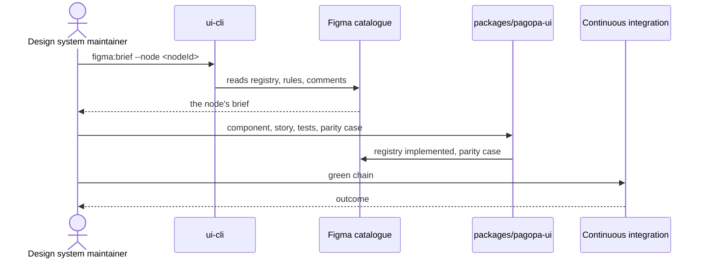

# `UC-01`: Implement a public component from a Figma node

**Linked JTBD**: N/A — confirmed: direct intake from the repository, no JTBD catalogue (see `open.item-011` of the parent DR).

**Primary actor**: Design system maintainer

**Secondary actors**: Design owner; Continuous integration

**Source artifact**: `CONTRIBUTING.md` § "Asking an agent — A new component"; `.agents/skills/pagopa-ui-standards/SKILL.md`; `.agents/skills/figma-to-code/SKILL.md`; node of the Figma library `pvhsJpPGQbEwNLiyP7BOIw`

**Service Blueprint step**: N/A — confirmed: no service blueprint (see `open.item-019` of the parent DR).

**Domain entities**: Figma node, Registry entry, Variant, Component, Family, Story, Guide, Parity case, Parity coverage, Token, Text contract, Green chain

**Trigger**: The maintainer asks to implement node `<nodeId>` as a public component, or the node enters a delta's work queue.

**Preconditions**:

- The node is published in the Figma library and is not in `excluded` status in the registry.
- The local catalogue snapshot is up to date, or a live read with a read-only token is available (`file_content:read`, `library_content:read`).
- The node's brief has been read and contains no `pending` rules: if it does, `uc-open-01` governs the order of the work.

**Main flow**:

1. The maintainer asks for the node's implementation, naming the identifier and the target family.
2. The system prints the node's brief: registry entry, the rules that target it, open comments and linked design requests.
3. The system creates the component in the documented family, with classes derived from the tokens and no arbitrary values.
4. The system adds the story with the variant controls and the declared accessibility contract.
5. The system adds the tests of the behaviour and of the text contract, with the messages in Italian and in English.
6. The system records the parity case for every variant verified on the declared device.
7. The system updates the public API report with the added export.
8. The system runs the green chain; if it is green, the maintainer opens the pull request and the reviewer merges it.

**Alternate flows**:

- `A1`: The node already has a registry entry in `mocked` status — the system reuses the existing identifier, replaces the provisional implementation and records the review outcome instead of creating a second entry.
- `A2`: The node declares more than one variant axis — the system implements the combinations the drawing allows and invents no others.

**Exception flows / edge cases**:

- `E1`: The node identifier does not exist in the library or belongs to an unpublished node -> Error: `FIGMA_NODE_UNKNOWN`
- `E2`: The local snapshot is older than the file's latest publication -> Error: `SNAPSHOT_STALE`
- `E3`: The node requires a token the manifest does not expose -> Error: `TOKEN_MISSING`
- `E4`: The story does not satisfy the accessibility contract -> Error: `A11Y_CONTRACT_FAILED`
- `E5`: The component imports from a layer that is not allowed -> Error: `LAYER_VIOLATION`
- `E6`: The export was added without regenerating the API report -> Error: `API_REPORT_STALE`
- `E7`: A variant received no parity case -> Error: `PARITY_CASE_UNRECORDED`

**Postconditions**:

- The component is exported from the public entry point and appears in the API report.
- The catalogue contains an `implemented` registry entry for the node, with the review date.
- Every declared variant has at least one recorded parity case and the node counts as covered.
- The Storybook catalogue shows at least one story of the component and the guide that cites it.

**Errors**:

- `FIGMA_NODE_UNKNOWN`: the identifier does not resolve to a published node -> the brief reports the node as unpublished and no file is created.
- `SNAPSHOT_STALE`: the snapshot predates the file's latest publication -> the work stops before any write and says to refresh the catalogue.
- `TOKEN_MISSING`: design variable required and not exposed by the manifest -> the component does not use a raw value in its place; the gap stays open and visible.
- `A11Y_CONTRACT_FAILED`: the story breaks the accessibility contract -> the component is not complete and the check fails, naming the story and the rule broken.
- `LAYER_VIOLATION`: import from a forbidden layer -> the boundary check fails and the pull request cannot be merged.
- `API_REPORT_STALE`: API report different from the exported surface -> the API check fails until the report is regenerated and committed.
- `PARITY_CASE_UNRECORDED`: variant implemented without a parity case -> the node stays outside coverage and the residue is visible in the parity report.

**Acceptance checks**:

- `AC-01`: The node's brief has been read and no `pending` rule targets it before the first write. - Evidence: `pnpm nx run pagopa-ui-cli:figma:brief --node <nodeId>`; `pnpm nx run pagopa-ui-cli:figma:rules:check`
- `AC-02`: The component is exported from `src/pagopa-ui.ts` and appears in the committed API report. - Evidence: `packages/pagopa-ui/etc/pagopa-ui.api.md`; `pnpm nx run pagopa-ui:api:check`
- `AC-03`: Every variant the node declares has at least one reviewed parity case. - Evidence: `packages/pagopa-ui/src/catalog/figma/parity-cases.json`; `pnpm nx run pagopa-ui-cli:figma:parity:verify`
- `AC-04`: The registry reports the node as `implemented` with the review date. - Evidence: `packages/pagopa-ui/src/catalog/figma/registry.json`; `pnpm nx run pagopa-ui:figma:check`
- `AC-05`: At least one story of the component exists and the accessibility contract passes. - Evidence: `pnpm nx run pagopa-ui-storybook:test:stories`
- `AC-06`: Every text the component renders or announces can be overridden by the consumer and has an Italian and an English value. - Evidence: `packages/pagopa-ui/src/lib/ui-provider/`; text contract tests
- `AC-07`: The component introduces no arbitrary style values and respects the class contract. - Evidence: `pnpm nx run pagopa-ui:foundation:check`
- `AC-08`: The component respects the import boundaries. - Evidence: `pnpm nx run pagopa-ui:layers:check`
- `AC-09`: The full green chain is green before the commit. - Evidence: `pnpm nx run workspace:verify`
- `AC-10`: When asked for a non-existent identifier, the system returns `FIGMA_NODE_UNKNOWN` and writes no file. - Evidence: `pnpm nx run pagopa-ui-cli:figma:brief --node <unknown>`

**Tracking events**:

- `N/A — confirmed`: the library emits no runtime tracking events (see `NFR-07` and `open.item-017` of the parent DR); the outcome signal is the workflows' outcome and the Git history.

**Relevant links**:

- Sequence diagram:

- Service Blueprint: N/A — confirmed (see `open.item-019` of the parent DR).
- Figma: library `pvhsJpPGQbEwNLiyP7BOIw`, node `<nodeId>`.
- DR components: `solution.components.item-001`, `solution.components.item-004`, `solution.components.item-005`, `solution.components.item-006`
- Endpoint / OpenAPI / AsyncAPI / Data Contract: `contracts.item-001` (public surface), `contracts.item-004` (inventory), `contracts.item-005` (registry), `contracts.item-006` (parity cases), `contracts.item-009` (text contract)
- Validation evidence: `pnpm nx run workspace:verify`; `packages/ui-cli/data/css-budget.json`

## Open questions and propagation

| ID           | Type              | Item                                                                                                                        | Impact / blocker                                                                                  | Owner | Resolution / link |
| ------------ | ----------------- | --------------------------------------------------------------------------------------------------------------------------- | ------------------------------------------------------------------------------------------------- | ----- | ----------------- |
| `uc-open-01` | question          | Does a rule in `pending` status that targets the node block the implementation, or is the node implemented and the rule closed afterwards? | Determines whether the node enters the main flow or must wait for a design decision                | TBD   | TBD               |
| `uc-open-02` | proposed decision | Is the parity case recorded per variant or per combination of axes?                                                          | Changes the number of cases produced and the granularity of the proof                               | TBD   | TBD               |
| `uc-open-03` | assumption        | A node in `mocked` status reuses the existing registry entry (flow `A1`)                                                     | If wrong, the registry accumulates duplicate entries for the same node                             | TBD   | TBD               |
