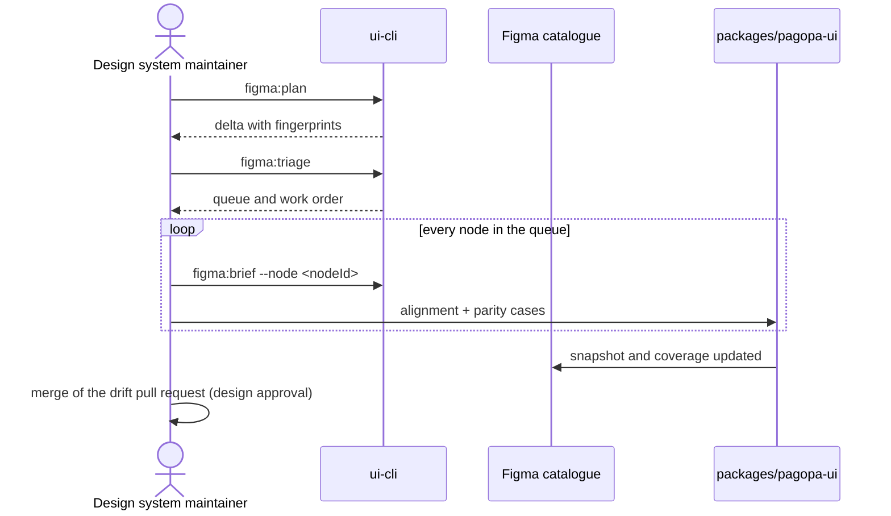

# `UC-02`: Align a component to a Figma delta

**Linked JTBD**: N/A — confirmed: direct intake from the repository (see `open.item-011` of the parent DR).

**Primary actor**: Design system maintainer

**Secondary actors**: Design owner; Continuous integration

**Source artifact**: `CONTRIBUTING.md` § "Asking an agent — A Figma delta"; `docs/decisions/0004` (gate limited to the delta, device policy vocabulary); `packages/pagopa-ui/src/catalog/figma/inventory.json`

**Service Blueprint step**: N/A — confirmed: no service blueprint (see `open.item-019` of the parent DR).

**Domain entities**: Delta, Figma node, Registry entry, Variant, Device, Parity case, Parity coverage, Bulk rule, Work order, Green chain

**Trigger**: Figma changed compared with the committed snapshot, or a weekly drift pull request is open.

**Preconditions**:

- A previous snapshot exists to compare the design fingerprint against.
- A live read of the file is available (read-only token) or a read-only export provided by the maintainer.
- The perimeter of the delta is known: the nodes involved and their status in the registry.

**Main flow**:

1. The maintainer asks for the alignment, declaring whether the work starts from the snapshot or from the drift pull request.
2. The system produces the delta plan: changed nodes, kind of change, fingerprint before and after, residue of uncensused surface.
3. The system triages the nodes and computes the work order from the dependencies.
4. For every node in the queue the system prints the brief and applies the decision: align, record as a reasoned exclusion, or open a design request.
5. The system aligns the component, updates the story and records the parity cases on the device involved.
6. The system closes the delta queue and verifies that every node has a recorded decision.
7. The system runs the green chain; the maintainer merges the drift pull request, which for drift is also the act of design approval.

**Alternate flows**:

- `A1`: The delta touches no implemented node — the system updates the snapshot and closes the queue without changing components.
- `A2`: The changed node is not published yet — the system records it as unpublished and assigns it no work.
- `A3`: The change is rule-only or comment-only — the system does not detect it as a delta, because the fingerprint does not cover them, and handles it through `UC-06`.

**Exception flows / edge cases**:

- `E1`: No usable previous snapshot exists -> Error: `BASELINE_SNAPSHOT_MISSING`
- `E2`: The file changed during the read and the fingerprints are not comparable -> Error: `SNAPSHOT_UNSTABLE`
- `E3`: A node in the queue has no recorded decision -> Error: `NODE_DECISION_MISSING`
- `E4`: The rendering diverges between devices with no recorded exception -> Error: `DEVICE_DIVERGENCE_UNRECORDED`
- `E5`: A node changes but stays covered by an unreviewed parity case -> Error: `PARITY_EVIDENCE_STALE`

**Postconditions**:

- The committed snapshot matches the file version that was worked.
- Every node of the delta has a recorded decision: aligned, excluded with a reason, or pending with an open design request.
- Parity coverage includes the nodes aligned in the delta.
- The drift pull request contains only the work of the delta and its description lists the nodes and the decisions.

**Errors**:

- `BASELINE_SNAPSHOT_MISSING`: the starting snapshot is missing -> the plan is not produced and no file is modified.
- `SNAPSHOT_UNSTABLE`: the file changed between two reads -> the work stops and asks for a fresh read, so as not to align to a version already superseded.
- `NODE_DECISION_MISSING`: the queue contains a node without a decision -> the queue cannot be closed and the pull request stays incomplete.
- `DEVICE_DIVERGENCE_UNRECORDED`: the mobile rendering diverges with no exception -> the device check fails and the divergence cannot pass silently.
- `PARITY_EVIDENCE_STALE`: the parity case refers to a previous variant -> the node does not count as covered until the case is realigned.

**Acceptance checks**:

- `AC-01`: The delta plan lists every changed node with the kind of change and the fingerprints before and after. - Evidence: `pnpm nx run pagopa-ui-cli:figma:plan`
- `AC-02`: The work order respects the dependencies: no dependent node precedes the node it depends on. - Evidence: `pnpm nx run pagopa-ui-cli:figma:triage`
- `AC-03`: Every node of the queue has a recorded decision before the close. - Evidence: `pnpm nx run pagopa-ui-cli:figma:status`
- `AC-04`: Divergences between devices are allowed only if they appear in the list of reasoned exceptions. - Evidence: `packages/pagopa-ui/src/catalog/figma/device-exceptions.json`; `pnpm nx run pagopa-ui-cli:figma:devices`
- `AC-05`: The aligned nodes have parity cases reviewed after the change. - Evidence: `pnpm nx run pagopa-ui-cli:figma:parity:verify`
- `AC-06`: The catalogue check is green after the alignment. - Evidence: `pnpm nx run pagopa-ui:figma:check`
- `AC-07`: The full green chain is green before the commit. - Evidence: `pnpm nx run workspace:verify`
- `AC-08`: With no starting snapshot, the system returns `BASELINE_SNAPSHOT_MISSING` and modifies no file. - Evidence: `ui-cli` tests on the synchronisation command

**Tracking events**:

- `N/A — confirmed`: no runtime tracking events (see `NFR-07` of the parent DR); the delta and its decisions live in the drift pull request and in the Git history.

**Relevant links**:

- Sequence diagram:

- Service Blueprint: N/A — confirmed (see `open.item-019` of the parent DR).
- Figma: library `pvhsJpPGQbEwNLiyP7BOIw`, version of the current snapshot.
- DR components: `solution.components.item-001`, `solution.components.item-005`, `solution.components.item-004`
- Endpoint / OpenAPI / AsyncAPI / Data Contract: `contracts.item-004`, `contracts.item-005`, `contracts.item-006`, `contracts.item-007`, `contracts.item-008`
- Validation evidence: `pnpm nx run pagopa-ui-cli:figma:parity:verify`; `docs/figma-drift-handoff.md`

## Open questions and propagation

| ID           | Type              | Item                                                                                                          | Impact / blocker                                                                             | Owner        | Resolution / link |
| ------------ | ----------------- | ------------------------------------------------------------------------------------------------------------- | -------------------------------------------------------------------------------------------- | ------------ | ----------------- |
| `uc-open-04` | question          | Does a node that is aligned but not yet reviewed by design stay in the queue of the next delta?                | Determines whether the review debt accumulates or is carried between deltas                   | TBD          | TBD               |
| `uc-open-05` | assumption        | The delta queue is closed when every node has a decision, not when parity is complete                          | If wrong, the delta is never closable until the aggregate coverage grows                      | TBD          | TBD               |
| `uc-open-06` | proposed decision | A change that touches only rules or comments is always handled through `UC-06`, with no second path            | Avoids introducing a second path for the same work                                           | design owner | TBD               |
