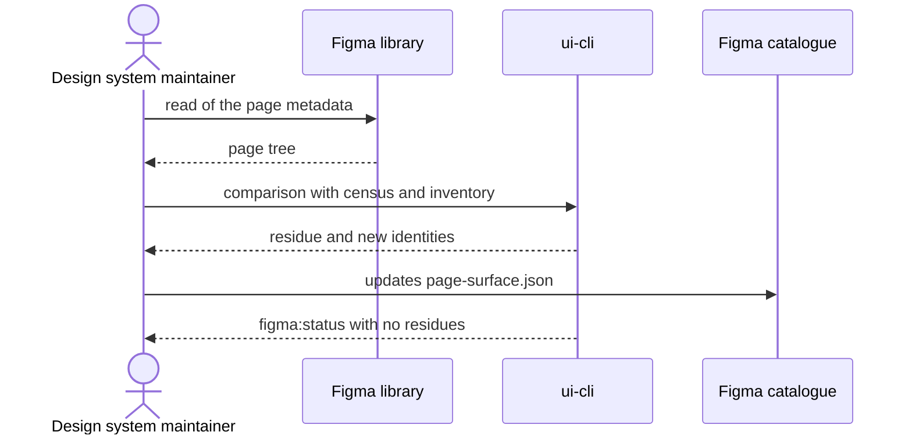

# `UC-03`: Census a Figma page and update its surface

**Linked JTBD**: N/A — confirmed: direct intake from the repository (see `open.item-011` of the parent DR).

**Primary actor**: Design system maintainer

**Secondary actors**: Design owner

**Source artifact**: `AGENTS.md` § "Figma sessions"; `packages/pagopa-ui/src/catalog/figma/page-surface.json`; `packages/pagopa-ui/src/catalog/figma/inventory.json`

**Service Blueprint step**: N/A — confirmed: no service blueprint (see `open.item-019` of the parent DR).

**Domain entities**: Page, Page census, Figma node, Inventory, Registry entry, Bulk rule

**Trigger**: A Figma session touches a page, or the delta plan reports a residue of uncensused surface.

**Preconditions**:

- The page exists in the file and its identification is known.
- A live read of the file is available, or a read-only export of the page structure.

**Main flow**:

1. The maintainer asks to census the page named.
2. The system reads the page tree with a metadata read and lists the published nodes.
3. The system compares the list with the recorded census and with the inventory.
4. The system updates the page census with the identities read and the read date.
5. The system reports the residue: identities published and not censused, identities censused and no longer present.
6. The system verifies that the count the status line declares matches the one of the census.
7. The system runs the catalogue check and the green chain.

**Alternate flows**:

- `A1`: The page is already censused and has not changed — the system updates only the read date and produces no work.
- `A2`: The page contains a node that has no registry entry but falls under a bulk rule — the system creates no individual entry and records the coverage through the rule.

**Exception flows / edge cases**:

- `E1`: The page does not exist or the identifier does not resolve -> Error: `PAGE_UNKNOWN`
- `E2`: A published identity is not listed in the census -> Error: `SURFACE_UNCENSUSED`
- `E3`: The census lists an identity the file no longer publishes -> Error: `CENSUS_ENTRY_ORPHANED`
- `E4`: The census was updated without re-reading the page tree -> Error: `CENSUS_READ_STALE`
- `E5`: The node has no registry entry and no rule covers it -> Error: `REGISTRY_COVERAGE_MISSING`

**Postconditions**:

- The page census reflects the latest read, with the recorded date.
- The status line reports the same number of identities twice and no uncensused residue.
- The inventory and the registry stay aligned to the census for the page.

**Errors**:

- `PAGE_UNKNOWN`: the page named is not in the file -> the census is not touched and the next read uses the same list.
- `SURFACE_UNCENSUSED`: a published identity exists with no census row -> the residue stays visible and blocks the declaration that the surface is complete.
- `CENSUS_ENTRY_ORPHANED`: the census names an identity that is no longer published -> the entry stays tracked as a residue to reconcile, it is not deleted silently.
- `CENSUS_READ_STALE`: the census declares a read that did not happen -> the catalogue check reports the read as invalid.
- `REGISTRY_COVERAGE_MISSING`: node with no entry and no rule -> the node is visible as uncovered and no work can declare it closed.

**Acceptance checks**:

- `AC-01`: The page census contains every published identity listed by the tree read. - Evidence: `packages/pagopa-ui/src/catalog/figma/page-surface.json`
- `AC-02`: The status line prints the same number of identities twice and the list of residues is empty. - Evidence: `pnpm nx run pagopa-ui-cli:figma:status`
- `AC-03`: The census carries a read date not earlier than the latest publication considered. - Evidence: `readAt` field in `page-surface.json`
- `AC-04`: The plan does not report the page in the uncensused residue list. - Evidence: `pnpm nx run pagopa-ui-cli:figma:plan`
- `AC-05`: Every censused node is covered by a registry entry or by a bulk rule. - Evidence: `pnpm nx run pagopa-ui:figma:check`
- `AC-06`: With a non-existent page, the system returns `PAGE_UNKNOWN` and does not modify the census. - Evidence: `ui-cli` tests on the census command

**Tracking events**:

- `N/A — confirmed`: no runtime tracking events (see `NFR-07` of the parent DR).

**Relevant links**:

- Sequence diagram:

- Service Blueprint: N/A — confirmed (see `open.item-019` of the parent DR).
- Figma: library `pvhsJpPGQbEwNLiyP7BOIw`, page `<pageNodeId>`.
- DR components: `solution.components.item-005`, `solution.components.item-004`
- Endpoint / OpenAPI / AsyncAPI / Data Contract: `contracts.item-004` (inventory), `contracts.item-005` (registry), `contracts.item-007` (surface census)
- Validation evidence: `pnpm nx run pagopa-ui:figma:check`; `pnpm nx run pagopa-ui-cli:figma:status`

## Open questions and propagation

| ID           | Type              | Item                                                                                  | Impact / blocker                                                                   | Owner | Resolution / link |
| ------------ | ----------------- | ------------------------------------------------------------------------------------- | ---------------------------------------------------------------------------------- | ----- | ----------------- |
| `uc-open-07` | question          | Must the census be redone for every page touched, or only for the pages with a delta? | Changes the cost of every Figma session and the frequency of the live read         | TBD   | TBD               |
| `uc-open-08` | proposed decision | An orphaned identity stays in the census marked as a residue instead of being removed | Preserves the historical trace, at the cost of a list that does not match the file | TBD   | TBD               |
