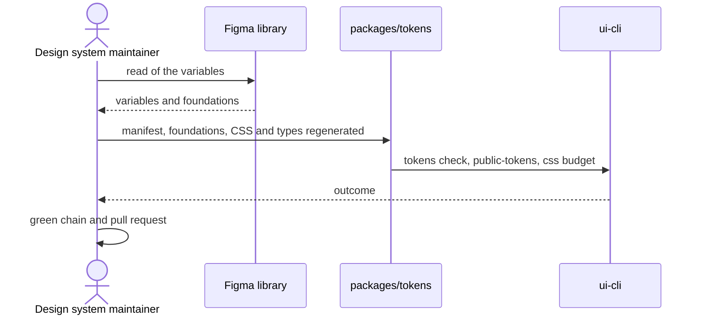

# `UC-04`: Update the tokens from the Figma variables

**Linked JTBD**: N/A — confirmed: direct intake from the repository (see `open.item-011` of the parent DR).

**Primary actor**: Design system maintainer

**Secondary actors**: Design owner; Continuous integration

**Source artifact**: `packages/tokens/src/manifest.json`, `packages/tokens/src/foundations.json`; `packages/ui-cli/data/css-budget.json`; `packages/ui-cli/src/cli.ts` (`tokens check`, `check public-tokens`)

**Service Blueprint step**: N/A — confirmed: no service blueprint (see `open.item-019` of the parent DR).

**Domain entities**: Token, Foundation, Figma node, Component, Green chain

**Trigger**: The variables of the Figma library change, or a component requires a token the manifest does not expose.

**Preconditions**:

- An up-to-date read of the file's variables exists.
- The manifest is in the current schema (`schemaVersion 2`).
- The exclusion policy is known: a variable that is not exported must have a recorded reason.

**Main flow**:

1. The maintainer asks for the token update, naming the source of the read.
2. The system compares the variables read with the manifest and classifies the differences: added, renamed, removed, changed in value.
3. The system updates the manifest and the foundations, keeping the deliberate exclusions with their reason.
4. The system regenerates the CSS and the token types.
5. The system verifies that manifest, generated CSS and types match.
6. The system verifies that the public tokens expose no entries that are not allowed.
7. The system verifies the budget of the compiled stylesheet.
8. The system runs the green chain; the maintainer opens the pull request.

**Alternate flows**:

- `A1`: The variable is renamed — the system treats the change as a removal plus an addition and requires the components that used it to be updated.
- `A2`: The variable is a foundation — the system updates the foundation entry and its alignment date, not only the token.

**Exception flows / edge cases**:

- `E1`: The manifest and the generated CSS diverge -> Error: `TOKEN_DRIFT`
- `E2`: A variable is not exported without a recorded reason -> Error: `TOKEN_EXCLUSION_UNJUSTIFIED`
- `E3`: The compiled stylesheet exceeds a declared ceiling -> Error: `CSS_BUDGET_EXCEEDED`
- `E4`: A public token belongs to a category not allowed on the surface -> Error: `PUBLIC_TOKEN_NOT_ALLOWED`
- `E5`: A variable read no longer exists and a component references it -> Error: `TOKEN_REFERENCE_BROKEN`

**Postconditions**:

- The manifest reflects the variables of the version read, with the reasoned exclusions.
- The generated CSS and types are aligned to the manifest.
- The compiled stylesheet stays within the declared ceilings.
- No component references a removed token.

**Errors**:

- `TOKEN_DRIFT`: manifest, CSS and types do not match -> the token check fails and no publication is possible.
- `TOKEN_EXCLUSION_UNJUSTIFIED`: exclusion with no reason -> the check fails and the exclusion stays visible as a gap.
- `CSS_BUDGET_EXCEEDED`: payload beyond the ceiling (200000 raw bytes, 30000 gzip, 20000 brotli) -> the build fails and the component that made the stylesheet grow must be reduced or moved.
- `PUBLIC_TOKEN_NOT_ALLOWED`: public token not allowed -> the public token check fails and the token stays internal.
- `TOKEN_REFERENCE_BROKEN`: component using a removed token -> the build fails on the component, not on the token.

**Acceptance checks**:

- `AC-01`: The manifest and the generated CSS match entry by entry. - Evidence: `pnpm nx run pagopa-ui-tokens:test`
- `AC-02`: Every variable that is not exported has a recorded reason in the manifest. - Evidence: `packages/tokens/src/manifest.json`; `pnpm nx run pagopa-ui-cli:tokens:check`
- `AC-03`: The compiled stylesheet stays within the three declared ceilings. - Evidence: `packages/ui-cli/data/css-budget.json`; `pnpm nx run pagopa-ui:build`
- `AC-04`: Only the allowed tokens are exposed as public. - Evidence: `pnpm nx run pagopa-ui-cli:tokens:public:check`
- `AC-05`: No component references a removed token. - Evidence: `pnpm nx run pagopa-ui:foundation:check`; `pnpm nx run pagopa-ui:typecheck`
- `AC-06`: The token contract is reachable from the package's declared subpaths. - Evidence: `packages/pagopa-ui/package.json` (`exports`); `pnpm nx run pagopa-ui:library:check`
- `AC-07`: The full green chain is green before the commit. - Evidence: `pnpm nx run workspace:verify`

**Tracking events**:

- `N/A — confirmed`: no runtime tracking events (see `NFR-07` of the parent DR).

**Relevant links**:

- Sequence diagram:

- Service Blueprint: N/A — confirmed (see `open.item-019` of the parent DR).
- Figma: library `pvhsJpPGQbEwNLiyP7BOIw`, design variables.
- DR components: `solution.components.item-002`, `solution.components.item-004`
- Endpoint / OpenAPI / AsyncAPI / Data Contract: `contracts.item-002` (entry point of the tokens), `contracts.item-003` (manifest of the tokens and of the foundations)
- Validation evidence: `pnpm nx run pagopa-ui-tokens:test`; `pnpm nx run pagopa-ui:build`

## Open questions and propagation

| ID           | Type              | Item                                                                                        | Impact / blocker                                                                       | Owner | Resolution / link |
| ------------ | ----------------- | ------------------------------------------------------------------------------------------- | -------------------------------------------------------------------------------------- | ----- | ----------------- |
| `uc-open-09` | question          | Is a renamed variable a breaking change for consumers or an internal detail?                 | Determines whether a version plan with a declared impact and a migration note is needed | TBD   | TBD               |
| `uc-open-10` | assumption        | The foundation's alignment date changes only when the value really changes                   | If wrong, the dates lose meaning as proof of alignment                                | TBD   | TBD               |
| `uc-open-11` | proposed decision | The CSS budget is an absolute ceiling and not a per-component ratio                          | A large component can consume the quota available to the others                       | TBD   | TBD               |
