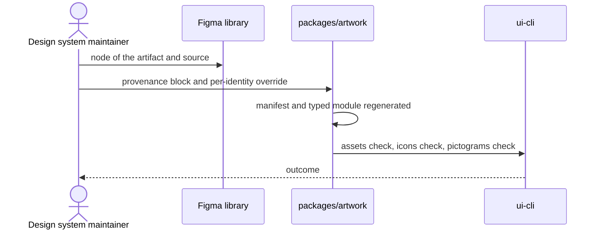

# `UC-05`: Add an icon or a pictogram with its provenance

**Linked JTBD**: N/A — confirmed: direct intake from the repository (see `open.item-011` of the parent DR).

**Primary actor**: Design system maintainer

**Secondary actors**: Design owner

**Source artifact**: `docs/decisions/0003` (artwork provenance); `packages/artwork`; `packages/ui-cli/src/cli.ts` (`assets:check`, `icons:check`, `pictograms:check`)

**Service Blueprint step**: N/A — confirmed: no service blueprint (see `open.item-019` of the parent DR).

**Domain entities**: Icon / Pictogram, Figma node, Bulk rule, Component, Story, Guide, Green chain

**Trigger**: Design publishes a new icon or a new pictogram, or a component requires a graphic artifact that is not present yet.

**Preconditions**:

- The artifact derives from a published node of the Figma library.
- The source and the licence of the artifact are known, or the gap is recorded as such.
- The bulk rule of the page it belongs to exists and allows a provenance block.

**Main flow**:

1. The maintainer requests the addition of the artifact, indicating source and licence.
2. The system records the provenance block in the bulk rule and, for icons, the optional per-identity override.
3. The system regenerates the manifest and the typed artwork module.
4. The system verifies that every published identity has its provenance and that it does not diverge from the policy.
5. The system labels in the catalogue every identity not derived from Material Symbols and links its Figma page.
6. The system updates the family guide and the licence note of the artifact distributed with the package.
7. The system runs the green chain; the maintainer opens the pull request.

**Alternate flows**:

- `A1`: The artifact is a third-party brand — the system classifies it as a logo, not as a glyph, and requires explicit provenance.
- `A2`: The artifact is a non-Material pictogram — the system records the source collection and the licence note in the family guide.

**Exception flows / edge cases**:

- `E1`: The provenance is not declared for a published identity -> Error: `PROVENANCE_MISSING`
- `E2`: The licence of the source is not verified -> Error: `LICENCE_UNVERIFIED`
- `E3`: The manifest diverges from the provenance policy -> Error: `PROVENANCE_DRIFT`
- `E4`: The identity does not exist in the source page -> Error: `ARTWORK_IDENTITY_UNKNOWN`
- `E5`: The artifact appears in the catalogue without a provenance label -> Error: `ARTWORK_LABEL_MISSING`

**Postconditions**:

- Every identity of the artwork carries a provenance resolved from the policy, with source and licence declared or explicitly open.
- The typed module exports the artifact and the catalogue shows it with its label.
- The licence note distributed with the package reflects the recorded provenance.

**Errors**:

- `PROVENANCE_MISSING`: published identity without a provenance block -> the artwork check fails and the artifact does not enter the package.
- `LICENCE_UNVERIFIED`: licence of the source not verified -> the artifact stays tracked and the distribution of the affected elements is blocked (see `open.item-003` of the parent DR).
- `PROVENANCE_DRIFT`: manifest and policy diverge -> the check fails until the manifest is regenerated.
- `ARTWORK_IDENTITY_UNKNOWN`: identity not present in the source page -> no artifact is generated.
- `ARTWORK_LABEL_MISSING`: non-Material identity without a label in the catalogue -> the documentation check fails.

**Acceptance checks**:

- `AC-01`: Every published identity of the artwork has a resolved and validated provenance. - Evidence: `pnpm nx run pagopa-ui-artwork:test`
- `AC-02`: Icons are verified separately from pictograms and both checks are green. - Evidence: `pnpm nx run pagopa-ui-cli:icons:check`; `pnpm nx run pagopa-ui-cli:pictograms:check`
- `AC-03`: The catalogue labels every identity not derived from Material Symbols and links its Figma page. - Evidence: `apps/storybook/src/guides/icons.md`, `apps/storybook/src/guides/pictograms.md`
- `AC-04`: The distributed package contains the licence note of the artwork. - Evidence: `dist/licenses/artwork.txt`; `pnpm nx run pagopa-ui:library:check`
- `AC-05`: The typed module exports the artifact and the library build includes it. - Evidence: `pnpm nx run pagopa-ui-artwork:assets:check`; `pnpm nx run pagopa-ui:build`
- `AC-06`: With a non-existent identity, the system returns `ARTWORK_IDENTITY_UNKNOWN` and generates no files. - Evidence: `ui-cli` tests on the artwork checks

**Tracking events**:

- `N/A — confirmed`: no runtime tracking events (see `NFR-07` of the parent DR).

**Relevant links**:

- Sequence diagram:

- Service Blueprint: N/A — confirmed (see `open.item-019` of the parent DR).
- Figma: icon and pictogram pages in the `pvhsJpPGQbEwNLiyP7BOIw` library.
- DR components: `solution.components.item-003`, `solution.components.item-004`, `solution.components.item-006`
- Endpoint / OpenAPI / AsyncAPI / Data Contract: `contracts.item-005` (registry, with the provenance block in the bulk rules), `contracts.item-010` (declared exceptions)
- Validation evidence: `pnpm nx run pagopa-ui-artwork:test`; `pnpm nx run pagopa-ui:library:check`

## Open questions and propagation

| ID           | Type     | Item                                                                                                       | Impact / blocker                                                                               | Owner        | Resolution / link |
| ------------ | -------- | ---------------------------------------------------------------------------------------------------------- | ---------------------------------------------------------------------------------------------- | ------------ | ----------------- |
| `uc-open-12` | question | Can an artifact with an unverified licence be distributed with a provisional note, or must it be excluded? | It determines whether `LICENCE_UNVERIFIED` blocks the package or only the conformity statement | design owner | `open.item-003`   |
| `uc-open-13` | question | Who verifies the licence of a new external source, and with which evidence?                                | Without an owner the verification has no closing point                                         | TBD          | TBD               |
