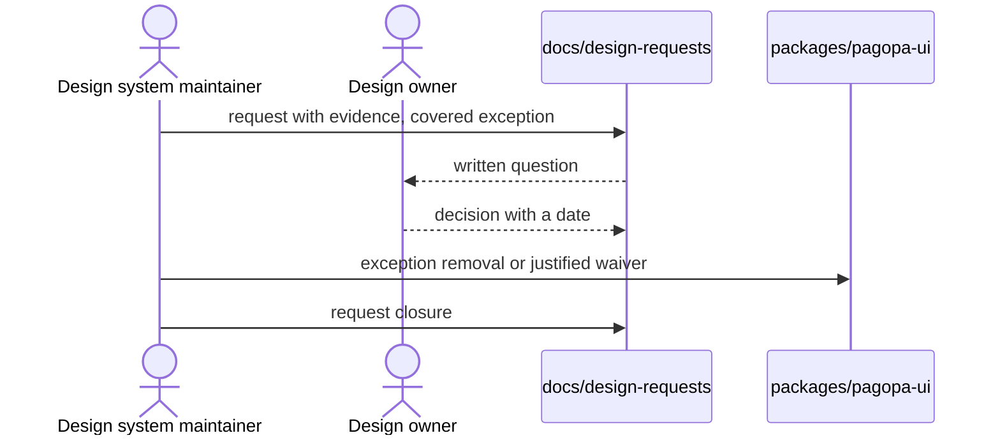

# `UC-06`: Open a design request and record its answer

**Linked JTBD**: N/A — confirmed: direct intake from the repository (see `open.item-011` of the parent DR).

**Primary actor**: Design system maintainer

**Secondary actors**: Design owner

**Source artifact**: `docs/design-requests/` (26 requests, `YYYY-MM-DD-<slug>.md` format); `.agents/skills/figma-to-code/SKILL.md` (design request flow); `AGENTS.md`

**Service Blueprint step**: N/A — confirmed: no service blueprint (see `open.item-019` of the parent DR).

**Domain entities**: Design request, Figma node, Bulk rule, Variant, Device, Story, Green chain

**Trigger**: A node, a rule or a variant has no answer in the design; or an exception has been declared so as not to block a check.

**Preconditions**:

- The subject of the request is identified: node, rule or set of stories.
- A declared exception or a suspended decision exists that the request must close.

**Main flow**:

1. The maintainer requests the opening of a design request for the indicated subject.
2. The system gathers the evidence: node brief, rules that concern it, affected stories, unmet criterion.
3. The system writes the request file with type, issue reference, status, decision owner and preview or reason for its absence.
4. The system lists the stories or nodes covered by the exception, each with the reason next to the flag.
5. The design owner answers and the decision is recorded in the request file.
6. The system closes the request by removing the exception from the story or recording the waiver in the list of justified exceptions.
7. The system runs the green chain.

**Alternate flows**:

- `A1`: The answer is "document the exception" — the system does not change the component and records the waiver with its reason and its date.
- `A2`: The request covers several families — the system writes it as a single request with the complete list of stories, and closes it when every group has an answer.

**Exception flows / edge cases**:

- `E1`: The request does not declare a decision owner -> Error: `REQUEST_WITHOUT_OWNER`
- `E2`: A story carries an exception without an open request that covers it -> Error: `EXEMPTION_WITHOUT_REQUEST`
- `E3`: The request is closed and the exception is still present in the story -> Error: `REQUEST_CLOSED_WITH_EXEMPTION`
- `E4`: The request cites stories or nodes that do not exist -> Error: `REQUEST_SUBJECT_UNKNOWN`
- `E5`: The request stays open beyond the agreed deadline -> Error: `REQUEST_STALE`

**Postconditions**:

- Every active exception has an open request that covers it, or a recorded waiver with a reason.
- Every closed request has a decision written in its own file.
- The story catalogue contains no orphan exceptions.

**Errors**:

- `REQUEST_WITHOUT_OWNER`: request without a decision owner -> the request is not valid and stays open without being closable.
- `EXEMPTION_WITHOUT_REQUEST`: uncovered exception -> the documentation check fails and the exception is not allowed.
- `REQUEST_CLOSED_WITH_EXEMPTION`: closure with the exception still active -> the check fails until the flag is removed or the waiver recorded.
- `REQUEST_SUBJECT_UNKNOWN`: non-existent request subject -> the request is not created.
- `REQUEST_STALE`: request without an answer beyond the deadline -> it stays visible as open debt and its exception does not become an implicit waiver.

**Acceptance checks**:

- `AC-01`: Every request file declares type, issue, status, decision owner and preview or reason for its absence. - Evidence: `docs/design-requests/`
- `AC-02`: Every story with a declared exception has an open request that covers it. - Evidence: `pnpm nx run pagopa-ui:docs`; `apps/storybook/src/support/a11y-contract.ts`
- `AC-03`: A closed request does not leave the exception active in the story. - Evidence: documentation check and search for the exception flags
- `AC-04`: The design owner's decision is written in the request file, with the date. - Evidence: `docs/design-requests/<file>.md`
- `AC-05`: The complete green chain is green after the closure. - Evidence: `pnpm nx run workspace:verify`
- `AC-06`: A request without a decision owner is rejected with `REQUEST_WITHOUT_OWNER`. - Evidence: the documentation check

**Tracking events**:

- `N/A — confirmed`: no runtime tracking events (see `NFR-07` of the parent DR); the request lifecycle lives in the file and in the linked issue.

**Relevant links**:

- Sequence diagram:

- Service Blueprint: N/A — confirmed (see `open.item-019` of the parent DR).
- Figma: node or page that is the subject of the request in the `pvhsJpPGQbEwNLiyP7BOIw` library.
- DR components: `solution.components.item-009`, `solution.components.item-001`
- Endpoint / OpenAPI / AsyncAPI / Data Contract: `contracts.item-008` (rules ledger), `contracts.item-010` (declared exceptions)
- Validation evidence: `pnpm nx run pagopa-ui:docs`; `docs/design-requests/2026-10-16-a11y-reflow-conditions.md`

## Open questions and propagation

| ID           | Type       | Item                                                                       | Impact / blocker                                                                      | Owner        | Resolution / link |
| ------------ | ---------- | -------------------------------------------------------------------------- | ------------------------------------------------------------------------------------- | ------------ | ----------------- |
| `uc-open-14` | question   | Which deadline turns an open request into `REQUEST_STALE`?                 | Without a deadline the request has no delay signal and the exception stays indefinite | design owner | `open.item-020`   |
| `uc-open-15` | assumption | A request closed with "document the exception" produces a permanent waiver | If wrong, every waiver would have to be reviewed at expiry                            | design owner | TBD               |
