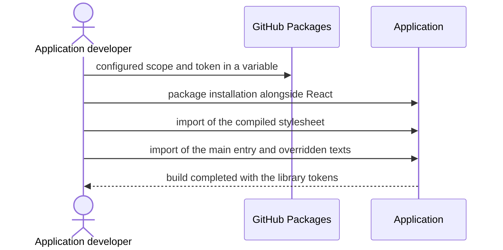

# `UC-07`: Consume the package in an application

**Linked JTBD**: N/A — confirmed: direct intake from the repository (see `open.item-011` of the parent DR).

**Primary actor**: PagoPA application developer

**Secondary actors**: GitHub Packages (registry), Package maintainer

**Source artifact**: `README.md` § "Consuming the library"; `packages/pagopa-ui/package.json` (exports and peer dependency); `docs/decisions/0004` (light theme only)

**Service Blueprint step**: N/A — confirmed: no service blueprint (see `open.item-019` of the parent DR).

**Domain entities**: Component, Token, Text, Guide, Green chain

**Trigger**: The application must adopt components of the PagoPA ecosystem and declares the dependency on the package.

**Preconditions**:

- The application uses React in the version declared as a peer dependency.
- The `@pagopa` scope is configured on the GitHub Packages registry, with a token holding package read permission.
- The application accepts the light theme only.

**Main flow**:

1. The developer configures the scope on the registry and the token in an environment variable.
2. The developer installs the package alongside React and ReactDOM.
3. The developer imports the compiled stylesheet once only.
4. The developer imports the component from the main entry.
5. The system exposes the component with the tokens already resolved, without requiring configuration of utility classes, aliases or font packages.
6. The developer overrides the visible and announced texts that the application must render in its own language.
7. The system builds the application with the declared module resolution.

**Alternate flows**:

- `A1`: The application does not want to include the CSS in the bundle — it imports the stylesheet from the secondary path or copies the distributed assets, without changing the tokens.
- `A2`: The application consumes only the tokens — it imports the dedicated path and not the main entry.

**Exception flows / edge cases**:

- `E1`: The installed React version is outside the declared range -> Error: `PEER_REACT_UNSATISFIED`
- `E2`: The scope is not configured and the installation does not resolve the package -> Error: `REGISTRY_NOT_CONFIGURED`
- `E3`: The stylesheet is not imported and the component has no style -> Error: `STYLESHEET_NOT_IMPORTED`
- `E4`: The project uses an undeclared module resolution and the types do not resolve -> Error: `MODULE_RESOLUTION_UNSUPPORTED`
- `E5`: The application declares the dependency on a non-existent export path -> Error: `EXPORT_PATH_UNKNOWN`

**Postconditions**:

- The component is rendered with the library tokens and the application texts.
- The application does not introduce Tailwind, shadcn, repository aliases or its own font packages.
- The application build completes with no resolution errors.

**Errors**:

- `PEER_REACT_UNSATISFIED`: peer dependency not satisfied -> the installation fails and the application cannot adopt the package.
- `REGISTRY_NOT_CONFIGURED`: scope not configured -> the package does not resolve and the installation fails.
- `STYLESHEET_NOT_IMPORTED`: stylesheet absent -> the component is rendered without style, with no build error.
- `MODULE_RESOLUTION_UNSUPPORTED`: module resolution not covered -> the types do not resolve and the application build fails.
- `EXPORT_PATH_UNKNOWN`: non-existent export path -> the resolution fails with a bundler error.

**Acceptance checks**:

- `AC-01`: The package declares the React peer dependency and an application that respects it installs and resolves it. - Evidence: `packages/pagopa-ui/package.json`; `pnpm nx run pagopa-ui:library:check`
- `AC-02`: The package exposes only the published paths and each of them resolves in an isolated application. - Evidence: `pnpm nx run pagopa-ui:library:check`
- `AC-03`: An isolated consuming application builds and renders a component by importing only the compiled stylesheet. - Evidence: `pnpm nx run pagopa-ui:library:check`
- `AC-04`: The package distributes fonts, licences and notices for the supported resolutions. - Evidence: `dist/licenses/artwork.txt`; `pnpm nx run pagopa-ui:library:check`
- `AC-05`: Every text visible or announced by the component can be overridden by the consumer. - Evidence: text contract tests; `pnpm nx run pagopa-ui:test`
- `AC-06`: The package requires no Tailwind, shadcn, repository aliases or font packages from the consumer. - Evidence: `pnpm nx run pagopa-ui:library:check`; `packages/pagopa-ui/package.json`

**Tracking events**:

- `N/A — confirmed`: no runtime tracking events (see `NFR-07` of the parent DR).

**Relevant links**:

- Sequence diagram:

- Service Blueprint: N/A — confirmed (see `open.item-019` of the parent DR).
- Figma: N/A — confirmed: the consumer does not read the Figma library.
- DR components: `solution.context.item-007`, `solution.components.item-006`
- Endpoint / OpenAPI / AsyncAPI / Data Contract: `contracts.item-001` (public surface and peer dependency), `contracts.item-002` (token and CSS entry point), `contracts.item-009` (text contract and message dictionary)
- Validation evidence: `pnpm nx run pagopa-ui:library:check` (artifact packaged in an isolated application)

## Open questions and propagation

| ID           | Type     | Item                                                                          | Impact / blocker                                                              | Owner | Resolution / link |
| ------------ | -------- | ----------------------------------------------------------------------------- | ----------------------------------------------------------------------------- | ----- | ----------------- |
| `uc-open-16` | question | Which module resolutions can an application use without a support guarantee?  | It determines the perimeter of `MODULE_RESOLUTION_UNSUPPORTED` and the proofs | TBD   | `open.item-009`   |
| `uc-open-17` | question | Must the stylesheet be imported once per application or once per entry point? | It changes the documented expectation and the `STYLESHEET_NOT_IMPORTED` case  | TBD   | TBD               |
