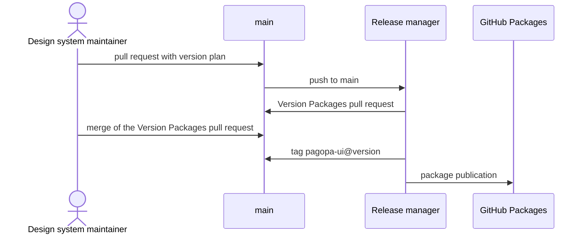

# `UC-08`: Publish a new version of the package

**Linked JTBD**: N/A — confirmed: direct intake from the repository (see `open.item-011` of the parent DR).

**Primary actor**: Design system maintainer

**Secondary actors**: Release manager (GitHub App), GitHub Packages (registry)

**Source artifact**: `.github/workflows/release.yaml`; `nx.json` § `release`; `.nx/version-plans/`; `packages/pagopa-ui/project.json` § `nx-release-publish`

**Service Blueprint step**: N/A — confirmed: no service blueprint (see `open.item-019` of the parent DR).

**Domain entities**: Version, Version plan, Component, Guide, Green chain

**Trigger**: A change of behaviour or of the public surface has entered `main` with a version plan.

**Preconditions**:

- The change has passed the green chain and the packaged artifact check.
- The version plan declares the increment for the package project.
- The release secrets and environment are configured.

**Main flow**:

1. The maintainer opens the pull request with the change and the version plan.
2. The system validates the change and flags a missing version plan.
3. The pull request is merged into `main`; the release workflow starts.
4. The release manager opens or updates the "Version Packages" pull request with the version, the changelog and the consumed plan.
5. The "Version Packages" pull request is merged.
6. The release manager creates the `pagopa-ui@<version>` tag and publishes the package to the GitHub Packages registry.
7. The system makes the new version installable by consumers.

**Alternate flows**:

- `A1`: Several version plans accumulate — the release manager adds them up in the same "Version Packages" pull request and consumes them together.
- `A2`: The release workflow is started manually — the system treats the run as an update of the same pull request, without creating tags when there is nothing to publish.

**Exception flows / edge cases**:

- `E1`: A version plan is missing for a public surface change -> Error: `VERSION_PLAN_MISSING`
- `E2`: The version plan declares a non-allowed increment -> Error: `VERSION_PLAN_INVALID`
- `E3`: The release environment lacks the secrets or the write permission on the registry -> Error: `RELEASE_AUTH_MISSING`
- `E4`: The version tag already exists -> Error: `RELEASE_TAG_CONFLICT`
- `E5`: The packaged artifact does not respect the export contract -> Error: `PACKAGE_CONTENT_INVALID`

**Postconditions**:

- A `pagopa-ui@<version>` tag exists and the package of the same version is published to the GitHub Packages registry.
- The project changelog contains the version entry, with authors and commit references.
- The consumed version plan is no longer present in the repository.

**Errors**:

- `VERSION_PLAN_MISSING`: no version plan for a change that requires one -> the release workflow produces no version and the pull request validation flags it.
- `VERSION_PLAN_INVALID`: non-allowed increment -> the "Version Packages" pull request is not opened.
- `RELEASE_AUTH_MISSING`: missing credentials or permissions -> the publication fails and no tag is considered final.
- `RELEASE_TAG_CONFLICT`: tag already existing -> the publication of the version is interrupted, without overwriting the tag.
- `PACKAGE_CONTENT_INVALID`: artifact outside the contract -> the package is not published.

**Acceptance checks**:

- `AC-01`: Every public surface change merged into `main` has a version plan that declares the increment. - Evidence: `.nx/version-plans/`; `.github/workflows/validate.yaml`
- `AC-02`: The release manager opens or updates the "Version Packages" pull request without publishing anything. - Evidence: `.github/workflows/release.yaml`
- `AC-03`: Merging the "Version Packages" pull request creates the `pagopa-ui@<version>` tag. - Evidence: `nx.json` § `release.releaseTag.pattern`; `.github/workflows/release.yaml`
- `AC-04`: The package is published to the GitHub Packages registry and not to npmjs. - Evidence: `packages/pagopa-ui/project.json` § `nx-release-publish.registry`
- `AC-05`: The changelog contains the version entry with authors and commit references. - Evidence: `packages/pagopa-ui/CHANGELOG.md`; `nx.json` § `release.changelog`
- `AC-06`: The consumed version plan is no longer present after the release. - Evidence: `.nx/version-plans/`
- `AC-07`: The packaged artifact respects the export contract before publication. - Evidence: `pnpm nx run pagopa-ui:library:check`

**Tracking events**:

- `N/A — confirmed`: no runtime tracking events (see `NFR-07` of the parent DR); the trace of the release is the tag, the changelog and the consumed plan.

**Relevant links**:

- Sequence diagram:

- Service Blueprint: N/A — confirmed (see `open.item-019` of the parent DR).
- Figma: N/A — confirmed: the release does not read the Figma library.
- DR components: `solution.components.item-006`, `execution.rollout`
- Endpoint / OpenAPI / AsyncAPI / Data Contract: `contracts.item-001` (package exports and peer dependency), `contracts.item-010` (declared exceptions)
- Validation evidence: `pnpm nx run workspace:verify`; `pnpm nx run pagopa-ui:library:check`; `.github/workflows/deep-checks.yml`

## Open questions and propagation

| ID           | Type     | Item                                                                              | Impact / blocker                                                                              | Owner | Resolution / link   |
| ------------ | -------- | --------------------------------------------------------------------------------- | --------------------------------------------------------------------------------------------- | ----- | ------------------- |
| `uc-open-18` | question | Which increment is due to a change that removes a component without replacing it? | It determines whether `VERSION_PLAN_INVALID` covers the removal or a dedicated rule is needed | TBD   | `execution.rollout` |
| `uc-open-19` | question | Is the package registry the only distribution channel foreseen for a version?     | If a second channel appeared, the publication contract would have to be extended              | TBD   | `open.item-009`     |
