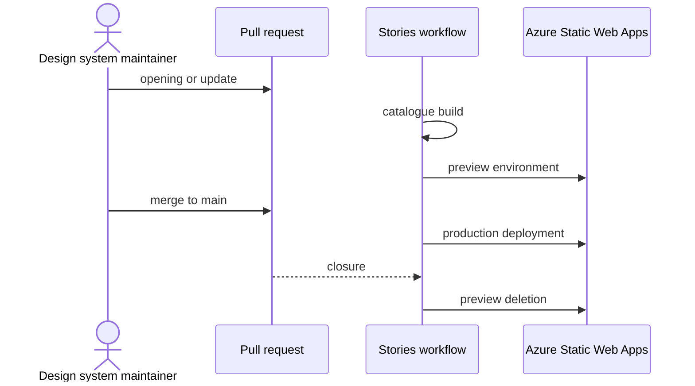

# `UC-09`: Publish the stories catalogue

**Linked JTBD**: N/A — confirmed: direct intake from the repository (see `open.item-011` of the parent DR).

**Primary actor**: Design system maintainer

**Secondary actors**: Design owner, PagoPA application developer, Azure Static Web Apps (hosting)

**Source artifact**: `.github/workflows/release-storybook.yaml`; `infra/resources/dev/static_web_app.tf`; `apps/storybook`

**Service Blueprint step**: N/A — confirmed: no service blueprint (see `open.item-019` of the parent DR).

**Domain entities**: Story, Component, Icon / Pictogram, Token, Guide, Design request, Green chain

**Trigger**: A change involves the stories application or one of the packages that feed it.

**Preconditions**:

- The hosting environment exists and is reachable from the workflow.
- The identity used by the workflow can write to the environment.
- The green chain has passed on the commit to publish.

**Main flow**:

1. The maintainer opens or updates a pull request that touches the stories or the packages that feed them.
2. The workflow builds the stories catalogue and uploads it as an artifact.
3. The system creates a preview environment for the pull request and publishes its address.
4. The reviewers read the stories in the preview.
5. On merge to `main`, the system builds and publishes the production deployment.
6. On closure of the pull request, the system deletes the related preview environment.

**Alternate flows**:

- `A1`: The pull request is the release one, which carries only the version and the changelog — the workflow builds no preview, because it would publish the site already online.
- `A2`: The workflow is started manually — the system builds and publishes the production deployment without creating previews.

**Exception flows / edge cases**:

- `E1`: The stories build fails -> Error: `STORIES_BUILD_FAILED`
- `E2`: The workflow identity cannot write to the environment -> Error: `DEPLOY_UNAUTHORIZED`
- `E3`: The preview of a closed pull request is not deleted -> Error: `PREVIEW_ORPHANED`
- `E4`: The published deployment does not contain an expected guide or story -> Error: `CATALOGUE_INCOMPLETE`
- `E5`: The workflow started on a commit that did not pass the green chain -> Error: `DEPLOY_UNVERIFIED_COMMIT`

**Postconditions**:

- The production deployment reflects the last commit merged to `main`.
- Every open pull request has at most one preview environment; every closed pull request has none left.
- The published catalogue exposes stories, guides, icons and pictograms of the published commit.

**Errors**:

- `STORIES_BUILD_FAILED`: build failed -> no publication, the preview keeps the last valid version or does not exist.
- `DEPLOY_UNAUTHORIZED`: missing write permissions -> the publication stops and production stays unchanged.
- `PREVIEW_ORPHANED`: preview not deleted -> the environment stays active beyond the life of the pull request and must be removed.
- `CATALOGUE_INCOMPLETE`: expected content missing -> the deployment is published but incomplete.
- `DEPLOY_UNVERIFIED_COMMIT`: unverified commit -> the publication is not allowed.

**Acceptance checks**:

- `AC-01`: A pull request that touches the stories or the packages gets a preview environment with its own address. - Evidence: `.github/workflows/release-storybook.yaml`
- `AC-02`: A merge to `main` publishes the production deployment. - Evidence: `.github/workflows/release-storybook.yaml`; `infra/resources/dev/static_web_app.tf`
- `AC-03`: Closing a pull request deletes the related preview environment. - Evidence: `.github/workflows/release-storybook.yaml` (types `closed`)
- `AC-04`: The release pull request produces no preview. - Evidence: `.github/workflows/release-storybook.yaml`
- `AC-05`: The published deployment contains the guides of the icons and of the pictograms. - Evidence: `apps/storybook/src/guides/icons.md`, `apps/storybook/src/guides/pictograms.md`; `pnpm nx run pagopa-ui:docs`
- `AC-06`: The published catalogue does not expose review stories beyond the life of their pull request. - Evidence: `.github/workflows/release-storybook.yaml`; `apps/storybook` (stories marked `!test` and `no-visual`)

**Tracking events**:

- `N/A — confirmed`: no runtime tracking event (see `NFR-07` of the parent DR).

**Relevant links**:

- Sequence diagram:

- Service Blueprint: N/A — confirmed (see `open.item-019` of the parent DR).
- Figma: review stories tied to the pull request `design.preview.branch` in the `pvhsJpPGQbEwNLiyP7BOIw` library.
- DR components: `solution.deployment.item-001`, `solution.deployment.item-002`, `solution.components.item-001`
- Endpoint / OpenAPI / AsyncAPI / Data Contract: N/A — confirmed: the parent DR declares no contract for the stories catalogue; the row is missing in `references.contracts` and must be added by the DR, not invented here.
- Validation evidence: `pnpm nx run pagopa-ui-storybook:build`; `.github/workflows/deep-checks.yml`

## Open questions and propagation

| ID           | Type     | Item                                                                               | Impact / blocker                                                                       | Owner | Resolution / link |
| ------------ | -------- | ---------------------------------------------------------------------------------- | -------------------------------------------------------------------------------------- | ----- | ----------------- |
| `uc-open-20` | question | Is the production deployment publicly reachable or does it require authentication? | It determines whether the catalogue is a public reference and how it must be announced | TBD   | `open.item-010`   |
| `uc-open-21` | question | How long does a preview stay valid after the last update of the pull request?      | Without a deadline it is undefined when `PREVIEW_ORPHANED` fires                       | TBD   | TBD               |
