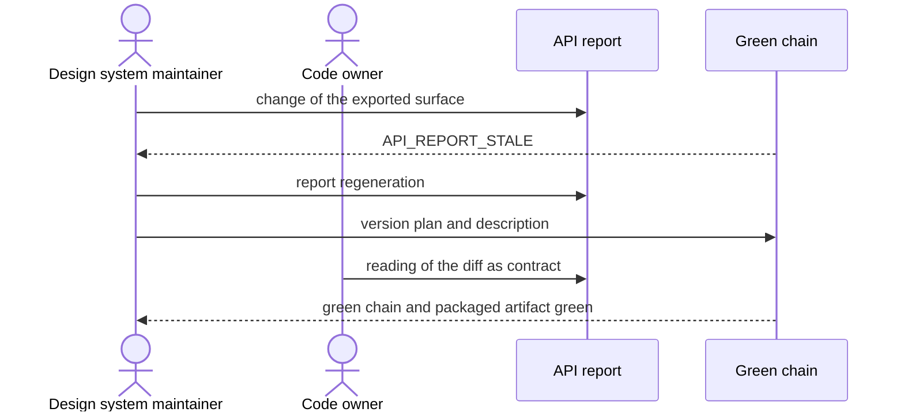

# `UC-10`: Handle a change that breaks the public surface

**Linked JTBD**: N/A — confirmed: direct intake from the repository (see `open.item-011` of the parent DR).

**Primary actor**: Design system maintainer

**Secondary actors**: PagoPA application developer, Review code owner

**Source artifact**: `packages/pagopa-ui/api-extractor.json`; `packages/pagopa-ui/etc/pagopa-ui.api.md`; `packages/pagopa-ui/src/catalog/figma/api-exceptions.json`; `CONTRIBUTING.md` § «Pull requests»

**Service Blueprint step**: N/A — confirmed: no service blueprint (see `open.item-019` of the parent DR).

**Domain entities**: Component, Version, Version plan, Declared exception, Story, Guide, Green chain

**Trigger**: A change alters the surface exported by the public entry point, or the way a component is rendered.

**Preconditions**:

- The repository contains a committed API report that represents the frozen surface.
- The change is described in the pull request.

**Main flow**:

1. The maintainer changes the public entry point or the rendering of a component.
2. The system builds the declarations and compares the surface with the committed report.
3. The system reports the difference and fails the API check until the report is updated.
4. The maintainer regenerates the report, attaches the version plan and describes the change in the pull request and in the changelog.
5. The reviewer reads the report diff as the contract of the change.
6. The system runs the green chain and the packaged artifact check.
7. The change is merged and the version plan carries it into the published version.

**Alternate flows**:

- `A1`: The change adds surface without removing any — the version plan declares a minor increment and the report records only the additions.
- `A2`: The exported surface is deliberately extended without a source Figma node — the extension is recorded with its rationale among the declared exceptions.

**Exception flows / edge cases**:

- `E1`: The surface changes and the report is not updated -> Error: `API_REPORT_STALE`
- `E2`: The change breaks the surface and has no version plan -> Error: `VERSION_PLAN_MISSING`
- `E3`: The deliberate extension is not recorded among the declared exceptions -> Error: `API_EXTENSION_UNDECLARED`
- `E4`: Removing an exception does not bring the component back into its source perimeter -> Error: `EXCEPTION_REVOKED_WITHOUT_SOURCE`
- `E5`: The committed report is regenerated without the pull request describing the change -> Error: `API_REPORT_UNDESCRIBED`

**Postconditions**:

- The committed API report matches the exported surface.
- Every extension without a source node has a written and dated rationale.
- The published version declares the increment the change requires.

**Errors**:

- `API_REPORT_STALE`: report not updated -> the API check fails and the publication does not happen.
- `VERSION_PLAN_MISSING`: no version plan for a break -> the pull request validation reports it and the release produces no version.
- `API_EXTENSION_UNDECLARED`: undeclared extension -> the catalogue coverage check fails.
- `EXCEPTION_REVOKED_WITHOUT_SOURCE`: waiver revoked without a source -> the component stays outside the perimeter and the alignment check fails.
- `API_REPORT_UNDESCRIBED`: report updated without a description -> the review cannot attribute the change and the pull request is not reviewable.

**Acceptance checks**:

- `AC-01`: Every change of the exported surface updates the committed report in the same pull request. - Evidence: `pnpm nx run pagopa-ui:api:update`; `pnpm nx run pagopa-ui:api:check`
- `AC-02`: Without an updated report the API check fails. - Evidence: `pnpm nx run pagopa-ui:api:check`
- `AC-03`: Every change of the public surface carries a version plan. - Evidence: `.nx/version-plans/`; `pnpm nx release plan:check`
- `AC-04`: Every extension without a source node is recorded with its rationale. - Evidence: `packages/pagopa-ui/src/catalog/figma/api-exceptions.json`
- `AC-05`: The change is described in the pull request and in the changelog. - Evidence: `CONTRIBUTING.md` § «Pull requests»; `packages/pagopa-ui/CHANGELOG.md`
- `AC-06`: The complete green chain and the packaged artifact check are green after the change. - Evidence: `pnpm nx run workspace:verify`; `pnpm nx run pagopa-ui:library:check`

**Tracking events**:

- `N/A — confirmed`: no runtime tracking event (see `NFR-07` of the parent DR); the trail is the report diff, the version plan and the changelog.

**Relevant links**:

- Sequence diagram:

- Service Blueprint: N/A — confirmed (see `open.item-019` of the parent DR).
- Figma: extensions without a node stay outside the alignment perimeter of the `pvhsJpPGQbEwNLiyP7BOIw` library.
- DR components: `solution.components.item-001`, `solution.components.item-004`, `solution.components.item-006`
- Endpoint / OpenAPI / AsyncAPI / Data Contract: `contracts.item-001` (public surface), `contracts.item-010` (declared exceptions)
- Validation evidence: `pnpm nx run pagopa-ui:api:check`; `pnpm nx run pagopa-ui:library:check`; `pnpm nx run workspace:verify`

## Open questions and propagation

| ID           | Type     | Item                                                                                 | Impact / blocker                                                                      | Owner        | Resolution / link |
| ------------ | -------- | ------------------------------------------------------------------------------------ | ------------------------------------------------------------------------------------- | ------------ | ----------------- |
| `uc-open-22` | question | Can a break of the surface happen before the first publication without an increment? | The surface is frozen until the first publication: the rule must be written or denied | devex        | `open.item-009`   |
| `uc-open-23` | question | Who approves the revocation of a declared exception?                                 | Without an approver the revocation has no decision trail                              | design owner | `open.item-020`   |
