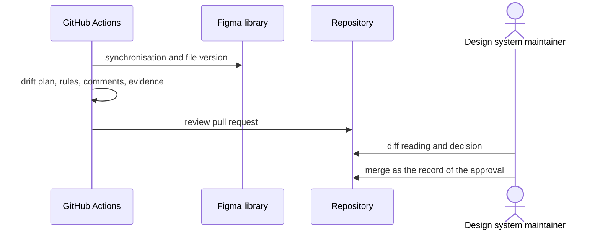

# `UC-11`: Govern the weekly drift of the Figma library

**Linked JTBD**: N/A — confirmed: direct intake from the repository (see `open.item-011` of the parent DR).

**Primary actor**: Design system maintainer

**Secondary actors**: Design owner, GitHub Actions (scheduled run), Figma library (source of truth)

**Source artifact**: `.github/workflows/figma-drift.yml`; `docs/decisions/0001-rework.md`; `packages/pagopa-ui/.figma/` (outcome of the synchronisation); `packages/ui-cli` (`figma:status`, `plan`, `triage`)

**Service Blueprint step**: N/A — confirmed: no service blueprint (see `open.item-019` of the parent DR).

**Domain entities**: Figma node, Bulk rule, Figma comment, Surface census, Inventory, Component, Figma file version

**Trigger**: The weekly schedule of the drift check falls due, or a person starts it manually.

**Preconditions**:

- The Figma token is available at run time and the committed inventory is readable.
- The person reviewing the diff has read-only access to the Figma library.
- The rules ledger and the comments have a committed snapshot to compare against.

**Main flow**:

1. The system synchronises the Figma library and compares the file version with the committed inventory.
2. The system produces the drift plan, the review body and the run artifacts.
3. The system updates the rules and the comments and reports their difference in the run record.
4. The system regenerates the evidence bundle and verifies its consistency.
5. The system formats the updated data and opens a single review pull request.
6. The maintainer reads the diff, which contains only the drift, and decides node by node.
7. The merge of the pull request is the record of the design approval.

**Alternate flows**:

- `A1`: The library has not changed against the inventory — the system opens no pull request and the run closes without a diff.
- `A2`: The difference concerns only rules or comments — the system reports them in the run record, without generating an automatic ledger.

**Exception flows / edge cases**:

- `E1`: The library has changed and the inventory is not updated -> Error: `DRIFT_UNREVIEWED`
- `E2`: A node of the queue is pending without a decision -> Error: `PENDING_NODE_UNDECIDED`
- `E3`: The Figma token is missing or expired -> Error: `FIGMA_TOKEN_MISSING`
- `E4`: The run cannot update the review branch -> Error: `DRIFT_BRANCH_GUARDED`
- `E5`: A rule that targets a reviewed node stays without a state -> Error: `RULE_EVIDENCE_STALE`

**Postconditions**:

- The committed inventory matches the Figma file version that was read.
- Every pending node of the queue has a recorded decision or stays visible as pending.
- The rules ledger and the comments have a state consistent with the library.
- There is a single review pull request for the drift, or none when the drift is empty.

**Errors**:

- `DRIFT_UNREVIEWED`: unreviewed drift -> the catalogue check fails and the drift is not approved.
- `PENDING_NODE_UNDECIDED`: pending node without a decision -> the node stays outside the parity coverage.
- `FIGMA_TOKEN_MISSING`: missing token -> the run stops and the drift is not detected that week.
- `DRIFT_BRANCH_GUARDED`: the review branch is not the expected one -> the system refuses to overwrite it and the review must be redone.
- `RULE_EVIDENCE_STALE`: rules evidence not updated -> the rules check fails.

**Acceptance checks**:

- `AC-01`: The scheduled run compares the library with the inventory and produces the drift plan. - Evidence: `.github/workflows/figma-drift.yml`; `pnpm nx run pagopa-ui-cli:figma:plan`
- `AC-02`: When the drift is empty, no pull request is opened. - Evidence: `.github/workflows/figma-drift.yml`
- `AC-03`: Every run with drift opens a single review pull request. - Evidence: `.github/workflows/figma-drift.yml`
- `AC-04`: The review diff contains only the drift and the formatted regenerated data. - Evidence: `.github/workflows/figma-drift.yml` (formatting step)
- `AC-05`: The rules ledger stays a reviewed change and not a generated one. - Evidence: `pnpm nx run pagopa-ui-cli:figma:rules`; `pnpm nx run pagopa-ui-cli:figma:rules:check`
- `AC-06`: The regenerated parity evidence passes its own verification. - Evidence: `pnpm nx run pagopa-ui-cli:figma:parity:evidence`; `pnpm nx run pagopa-ui-cli:figma:parity:verify`
- `AC-07`: A person without a Figma token can read the drift state. - Evidence: `pnpm nx run pagopa-ui-cli:figma:status`

**Tracking events**:

- `N/A — confirmed`: no runtime tracking event (see `NFR-07` of the parent DR); the trail is the review pull request and the `delta.json` and `run.json` artifacts.

**Relevant links**:

- Sequence diagram:

- Service Blueprint: N/A — confirmed (see `open.item-019` of the parent DR).
- Figma: `pvhsJpPGQbEwNLiyP7BOIw` library, file version recorded in the inventory, `.Regole` rules and open comments.
- DR components: `solution.components.item-004`, `solution.components.item-005`, `solution.context.item-001`
- Endpoint / OpenAPI / AsyncAPI / Data Contract: `contracts.item-004` (inventory), `contracts.item-005` (registry), `contracts.item-007` (surface census), `contracts.item-008` (rules ledger and device policy)
- Validation evidence: `pnpm nx run pagopa-ui-cli:figma:check`; `pnpm nx run pagopa-ui:figma:check`; `pnpm nx run pagopa-ui-cli:figma:rules:check`

## Open questions and propagation

| ID           | Type     | Item                                                                               | Impact / blocker                                                                    | Owner        | Resolution / link |
| ------------ | -------- | ---------------------------------------------------------------------------------- | ----------------------------------------------------------------------------------- | ------------ | ----------------- |
| `uc-open-24` | question | Who reviews the drift when the design owner is absent for more than a week?        | Without a substitute reviewer the drift accumulates and `DRIFT_UNREVIEWED` persists | design owner | `open.item-020`   |
| `uc-open-25` | question | Does a drift that touches a pending node suspend the review or close it partially? | It determines how many nodes stay pending after a review                            | TBD          | `open.item-020`   |
