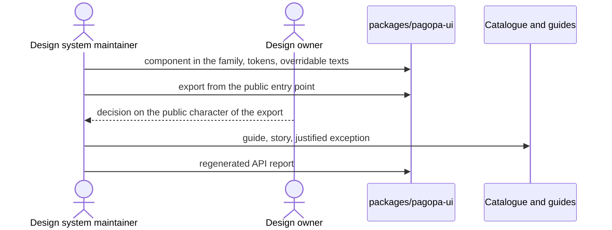

# `UC-12`: Add a public component without a Figma node

**Linked JTBD**: N/A — confirmed: direct intake from the repository (see `open.item-011` of the parent DR).

**Primary actor**: Design system maintainer

**Secondary actors**: Design owner, PagoPA application developer

**Source artifact**: `.agents/skills/pagopa-ui-standards/references/definition-of-done.md`; `packages/pagopa-ui/src/pagopa-ui.ts`; `packages/pagopa-ui/src/catalog/figma/api-exceptions.json`; `packages/pagopa-ui/etc/pagopa-ui.api.md`

**Service Blueprint step**: N/A — confirmed: no service blueprint (see `open.item-019` of the parent DR).

**Domain entities**: Component, Text, Story, Guide, Declared exception, Green chain, Version

**Trigger**: A need of the application has no node in the Figma library but requires a stable component of the ecosystem.

**Preconditions**:

- The component reuses existing primitives, families and tokens, with no new markup where an existing element is enough.
- The decision to make it public is taken by the responsible person, because the surface is frozen until the first publication.
- The reason why the component has no source node is declarable.

**Main flow**:

1. The maintainer places the component in the family that describes its behaviour and checks the import layers.
2. The maintainer writes the component with tokens, no fixed text and no sample data.
3. The maintainer exposes the component from the family index file and from the public entry point.
4. The maintainer documents the choice: the component guide records the behaviour, the adaptation and the reason for the absence of a source node.
5. The system records the exception among the declared exceptions, with its rationale.
6. The system regenerates the API report and records the new export.
7. The system verifies the catalogue coverage and the green chain.
8. The system publishes the component in the next version.

**Alternate flows**:

- `A1`: The component is internal — it stays out of the public entry point and is not recorded as an exception.
- `A2`: The source node exists but is not published yet — the component does not enter the alignment perimeter and the gap stays in the ledger of unpublished identities.

**Exception flows / edge cases**:

- `E1`: The exported component has neither a source node nor a declared exception -> Error: `NO_SOURCE_UNEXCEPTED`
- `E2`: The exported component has no guide recording its behaviour -> Error: `GUIDE_MISSING`
- `E3`: The component places an import against the declared layers -> Error: `LAYER_VIOLATION`
- `E4`: A visible or announced text is not overridable by the consumer -> Error: `TEXT_NOT_OVERRIDABLE`
- `E5`: The new export is not recorded in the committed API report -> Error: `API_REPORT_STALE`
- `E6`: The exception is recorded without a rationale -> Error: `EXCEPTION_UNJUSTIFIED`

**Postconditions**:

- The component is exported, documented, covered by at least one story and by a text contract test.
- The absence of the source node is recorded with a rationale, not inferred.
- The API report reflects the new export and the version plan accompanies it.

**Errors**:

- `NO_SOURCE_UNEXCEPTED`: export with no source and no exception -> the catalogue coverage check fails.
- `GUIDE_MISSING`: missing guide -> the definition of done is not met and the documentation check fails.
- `LAYER_VIOLATION`: import against the layers -> the layers check fails.
- `TEXT_NOT_OVERRIDABLE`: text not overridable -> the check of the text default values fails.
- `API_REPORT_STALE`: report not updated -> the API check fails.
- `EXCEPTION_UNJUSTIFIED`: exception without a rationale -> the exception is not allowed and the check fails.

**Acceptance checks**:

- `AC-01`: The component lives in the family coherent with its behaviour and the imports respect the layers. - Evidence: `pnpm nx run pagopa-ui:layers:check`
- `AC-02`: Every visible or announced text is overridable by the consumer and no default value is a literal in the component. - Evidence: `pnpm nx run pagopa-ui:text-defaults:check`; `pnpm nx run pagopa-ui:test`
- `AC-03`: The component is exported from the public entry point and the committed API report records it. - Evidence: `packages/pagopa-ui/src/pagopa-ui.ts`; `pnpm nx run pagopa-ui:api:update`
- `AC-04`: The absence of the source node is recorded with a rationale among the declared exceptions. - Evidence: `packages/pagopa-ui/src/catalog/figma/api-exceptions.json`
- `AC-05`: The component guide records behaviour, adaptations and the reason for the absence of the node. - Evidence: `apps/storybook/src/guides`; `pnpm nx run pagopa-ui:docs`
- `AC-06`: The component has at least one story in the catalogue and the catalogue coverage is green. - Evidence: `pnpm nx run pagopa-ui:figma:check`; `apps/storybook`
- `AC-07`: The complete green chain is green. - Evidence: `pnpm nx run workspace:verify`

**Tracking events**:

- `N/A — confirmed`: no runtime tracking event (see `NFR-07` of the parent DR).

**Relevant links**:

- Sequence diagram:

- Service Blueprint: N/A — confirmed (see `open.item-019` of the parent DR).
- Figma: N/A — confirmed: the component has no source node; the declared exception records its reason.
- DR components: `solution.components.item-001`, `solution.components.item-005`, `solution.components.item-008`
- Endpoint / OpenAPI / AsyncAPI / Data Contract: `contracts.item-001` (public surface), `contracts.item-009` (text contract), `contracts.item-010` (declared exceptions)
- Validation evidence: `pnpm nx run pagopa-ui:layers:check`; `pnpm nx run pagopa-ui:api:check`; `pnpm nx run pagopa-ui:figma:check`

## Open questions and propagation

| ID           | Type     | Item                                                                               | Impact / blocker                                                                                    | Owner        | Resolution / link |
| ------------ | -------- | ---------------------------------------------------------------------------------- | --------------------------------------------------------------------------------------------------- | ------------ | ----------------- |
| `uc-open-26` | question | Can a component without a node stay public indefinitely or does it have an expiry? | It determines whether `NO_SOURCE_UNEXCEPTED` becomes a permanent guardrail or a time-limited waiver | design owner | `open.item-020`   |
| `uc-open-27` | question | Who decides that a component born internal becomes public?                         | The surface is frozen until the first publication: the decision has a single owner                  | design owner | `open.item-009`   |
